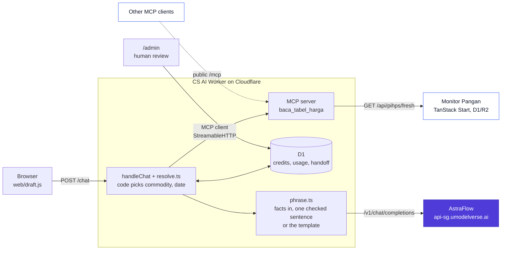

<Eyebrow>Online workshop · 120 minutes · hands-on</Eyebrow>

# How to Start Building an AI SaaS for Enterprise with AstraFlow

<p class="lede" style="max-width:31rem;margin-top:1.1rem">One real support app. A few bugs on purpose.<br/>We fix them together, line by line.</p>

<div class="flex items-center gap-4 mt-10">
  
  <span class="muted" style="font-size:1.1rem">x</span>
  
</div>

<div class="mt-4" style="font-family:'JetBrains Mono',monospace;font-size:0.8rem;letter-spacing:0.08em;text-transform:uppercase;color:var(--af-ink)">
Aldi x UCLOUD Global
</div>

<!--
Open with the title on screen. Wait for people to join.

"Today we build, not just talk.
One real support app, a few bugs I planted on purpose, and we fix them together."

Keep this short. Move to the intro.
-->

---
transition: fade-out
---

<div class="h-full flex flex-col">
<Eyebrow>Who I am</Eyebrow>

<div class="flex items-end justify-between">
  <div>
    <div style="font-size:5.6rem;font-weight:800;letter-spacing:-0.045em;line-height:0.95">I'm Aldi.</div>
    <div class="lede mt-3" style="font-size:1.45rem">Naufaldi Rafif Satriya</div>
    <div class="mt-2" style="font-family:'JetBrains Mono',monospace;font-size:0.85rem;color:var(--af-muted)">Find me <span style="color:var(--af-primary);font-weight:600">@F2aldi</span></div>
  </div>
  <IdCard v-motion :initial="{ y: 16, opacity: 0 }" :enter="{ y: 0, opacity: 1, transition: { delay: 150 } }" />
</div>

<div class="facts">
  <div class="fact" v-click>
    <div class="fact-k">Role</div>
    <div class="fact-v">Senior Software Engineer</div>
    <div class="fact-s">PT Sukanda Djaya (Diamond Cold Storage)</div>
  </div>
  <div class="fact" v-click>
    <div class="fact-k">Builds</div>
    <div class="fact-v">Monitor Pangan<br/>and the CS AI helper</div>
    <div class="fact-s">naufaldi.com · github.com/naufaldi</div>
  </div>
  <div class="fact" v-click>
    <div class="fact-k">Based in</div>
    <div class="fact-v">Bekasi / Jakarta</div>
  </div>
</div>
</div>

<style>
.facts { display: flex; gap: 2.2rem; margin-top: auto; margin-bottom: 1.2rem; }
.fact { flex: 1; border-top: 3px solid var(--af-ink); padding-top: 0.8rem; }
.fact-k { font-family: 'JetBrains Mono', monospace; font-size: 0.68rem; letter-spacing: 0.12em; text-transform: uppercase; color: var(--af-muted); }
.fact-v { margin-top: 0.5rem; font-weight: 700; font-size: 1.65rem; letter-spacing: -0.03em; line-height: 1.08; }
.fact-s { margin-top: 0.35rem; font-size: 0.9rem; color: var(--af-ink-2); }
</style>

<!--
Keep this under a minute.

"I'm Aldi. Senior Software Engineer at Sukanda Djaya, Diamond Cold Storage. Bekasi and Jakarta."

"I built Monitor Pangan and the CS AI helper. Today I'm here as an engineer, showing how I built it."

No CV dump. The app is the star today.
-->

---

<Eyebrow>Today</Eyebrow>

# 120 minutes. Five parts.

<div class="grid grid-cols-[1.15fr_1fr] gap-8 mt-2">
<div>

<table class="agenda">
<tbody>
<tr v-click><td class="t">10 min</td><td><b>Opening</b><br/><span class="muted small">why build this, what you leave with</span></td></tr>
<tr v-click><td class="t">20 min</td><td><b>The product</b><br/><span class="muted small">the case, the flow, MCP, AstraFlow</span></td></tr>
<tr v-click><td class="t">10 min</td><td><b>Setup</b><br/><span class="muted small">clone, <code>.dev.vars</code>, <code>db:migrate:local</code>, <code>npm run dev</code></span></td></tr>
<tr v-click><td class="t">55 min</td><td><b>Fix it together</b><br/><span class="muted small">solid, priceable, trustworthy</span></td></tr>
<tr v-click><td class="t">25 min</td><td><b>Wrap</b><br/><span class="muted small">is your idea worth building? Q&amp;A</span></td></tr>
</tbody>
</table>

</div>
<div v-click class="card tint">

### How the lab works

- you get the source code with bugs inside
- you try first, then I show the fix
- tests start red, that's normal
- AstraFlow key and free credits come today
- sample data only, no real customer data

</div>
</div>

<style>
.agenda { width: 100%; border-collapse: collapse; }
.agenda td { padding: 0.42rem 0.4rem; border-bottom: 1px solid var(--af-line); vertical-align: top; font-size: 0.98rem; }
.agenda td.t { font-family: 'JetBrains Mono', monospace; font-size: 0.8rem; color: var(--af-primary); width: 5rem; padding-top: 0.55rem; }
</style>

<!--
Walk the five rows with the arrow key.

The big block is "Fix it together". 55 minutes. That's the point of today.

Say clearly: you try first, I show the fix after.
Red tests at the start are on purpose. Don't panic.
Please don't paste real customer data anywhere.
-->

---

<Eyebrow>Why we're here</Eyebrow>

# Every company wants AI features.<br/>Few demos become a product they pay for.

<div class="grid grid-cols-2 gap-6 mt-6">
<div class="card surface" v-click>
<h3>A demo</h3>

- answers one question, on stage
- uses whatever model was handy
- never says what one answer costs
- nobody asks where the data goes

</div>
<div class="card tint" v-click>
<h3>A product a company pays for</h3>

- answers the 1,000th question the same way
- has a cost per request you can explain
- keeps customer data where it should be
- has a person to call when it's wrong

</div>
</div>

<p class="lede mt-5" v-click>So what's the gap? Mostly not the model.<br/>It's everything around it.</p>

<!--
Start with the why. Not the code.

These are observations, not stats. Ask the room: who has built an AI demo? Who got a company to pay for it?

The gap between the two columns is what we build today.
-->

---

<Eyebrow>Why we're here</Eyebrow>

# What a company asks before it pays

<div class="grid grid-cols-2 gap-4 mt-5">
<div class="card q" v-click><div class="qn">1</div><div><b>Is it correct?</b><div class="small muted">Where does the answer come from?</div></div></div>
<div class="card q" v-click><div class="qn">2</div><div><b>What does one request cost?</b><div class="small muted">And what will it cost at 100x the volume?</div></div></div>
<div class="card q" v-click><div class="qn">3</div><div><b>Where does our data go?</b><div class="small muted">Keys, customer messages, logs.</div></div></div>
<div class="card q" v-click><div class="qn">4</div><div><b>Who's accountable when it's wrong?</b><div class="small muted">Is there a human in the loop?</div></div></div>
</div>

<p class="lede mt-6" v-click>Today's app answers all four. In code you can read.<br/>We come back to these at the end.</p>

<style>
.q { display: flex; gap: 0.9rem; align-items: flex-start; }
.qn { flex: 0 0 2rem; height: 2rem; border-radius: 10px; display: grid; place-items: center; background: var(--af-primary); color: #fff; font-weight: 800; font-family: 'JetBrains Mono', monospace; }
.q b { font-size: 1.1rem; }
</style>

<!--
These four questions are the real buying criteria.

Correct. Cost. Data. Accountability.

If you can't answer them, the deal stops, no matter how good the demo looks.
-->

---

<Eyebrow>Why we're here</Eyebrow>

# Why SaaS for companies? And why you?

<div class="grid grid-cols-[1.1fr_1fr] gap-8 mt-4 items-start">
<div>
<p class="lede" v-click>Companies have problems that repeat every day.<br/>With real data behind them.</p>
<p class="lede mt-4" v-click>They pay to have one solved, every month.<br/>Not for a chat toy.</p>
<p class="lede mt-4" v-click>That's the chance for individual builders.</p>
</div>
<div class="card tint" v-click>
<h3>You don't need a big team</h3>

You need

- one narrow problem
- data you can trust
- a cost you can explain
- an answer to the four questions

</div>
</div>

<!--
Why SaaS? Because a recurring problem means recurring revenue.

Why you? Because one narrow feature doesn't need a big team. You don't need to work at a big company to build this.

That's who this workshop is for. Developers, founders, product builders.
-->

---

<Eyebrow>Why a gateway</Eyebrow>

# Why build on a gateway like AstraFlow?

<div class="grid grid-cols-2 gap-4 mt-5">
<div class="card" v-click><h3>One OpenAI-compatible API</h3><div class="small">Same request format many tools and SDKs already use.</div></div>
<div class="card" v-click><h3>Model choice</h3><div class="small">Many models behind one endpoint. Change one string to switch.</div></div>
<div class="card" v-click><h3>One key, on your server</h3><div class="small">The key lives in the Worker. The browser never sees it.</div></div>
<div class="card tint" v-click><h3>Usage you can measure</h3><div class="small">Every response returns <code>usage</code>. That's what you price on.</div></div>
</div>

<p class="small muted mt-5" v-click>That covers questions 2 and 3 at the API level. Questions 1 and 4 are on us, in our code.</p>

<!--
Keep this factual. OpenAI-compatible, many models, usage in every response. That's from the AstraFlow docs.

The key on the server is our design choice, and the gateway makes it easy.

Correctness and accountability are not something a gateway gives you. That's our job today.
-->

---

<Eyebrow>What you'll leave with</Eyebrow>

# By the end of today, you'll have

<div class="grid grid-cols-[1.25fr_1fr] gap-8 mt-3">
<div>
<Step n="1" v-click>A first AstraFlow request, and you know its token usage.</Step>
<Step n="2" v-click>A simple map of your SaaS feature. Where customer data and human review fit.</Step>
<Step n="3" v-click>A rough cost and pricing estimate.</Step>
<Step n="4" v-click tone="ok">One next step to test your idea.</Step>
</div>
<div class="card tint" v-click>
<h3>Provided today</h3>

- AstraFlow account access and an API key
- free workshop credits for the lab
- the AstraFlow team, for setup and your use case

<p class="small muted mt-2">Sample data only. Please don't bring real customer data.</p>
</div>
</div>

<!--
This is the promise from the Luma page. Say it plainly.

Credits and the key are for the lab. The AstraFlow team is in the room for questions.
-->

---

<Eyebrow>The product</Eyebrow>

# Two apps. Both live. Scan and try.

<div class="grid grid-cols-2 gap-6 mt-4">
<div class="card flex gap-5 items-center" v-click>
  <Qr src="/qr/monitor-pangan.png" label="Monitor Pangan" url="monitor.naufaldi.com" :size="168" />
  <div>
    <h3>The data source</h3>
    <div class="small">Food prices per province, per trading date.</div>
    <div class="small mt-2 muted">TanStack Start, React 19, a Worker with D1 and R2.</div>
    <div class="mt-2"><code>/api/pihps/fresh</code></div>
  </div>
</div>
<div class="card flex gap-5 items-center" v-click>
  <Qr src="/qr/cs-ai.png" label="CS AI helper" url="monitor-pangan-support…workers.dev" :size="168" />
  <div>
    <h3>The support chat</h3>
    <div class="small">Answers price questions from Monitor Pangan's table.</div>
    <div class="small mt-2 muted">Cloudflare Workers, D1, MCP, AstraFlow.</div>
    <div class="mt-2"><code>POST /chat</code></div>
  </div>
</div>
</div>

<p class="small muted mt-3">The starter code for today is on GitHub: <code>naufaldi/astra-cs</code>, branch <code>workshop-broken</code>.</p>

<p class="mt-3 lede" v-click>Today we take the second one apart.<br/>Then we put it back together, working.</p>

<!--
Ask people to scan both QR codes now.

Monitor Pangan is the data. The CS AI helper is the product we work on today.

Try asking the helper "harga cabai rawit di Jawa Barat?" and watch it answer with a trading date.
-->

---

<Eyebrow>The case</Eyebrow>

# Why this case?

<div class="grid grid-cols-[1.1fr_1fr] gap-8 mt-3 items-start">
<div>
  <div class="quote">"Berapa harga cabai di provinsi saya?"</div>
  <div class="muted mt-1">What's the price of chili in my province?</div>
  <p class="lede mt-5" v-click>Support gets it every day.<br/>Support gets overwhelmed.</p>
</div>
<div>
<Step n="1" v-click>The question repeats. Different province, same question.</Step>
<Step n="2" v-click tone="blue">The answer must come from real data. One price table, by trading date.</Step>
<Step n="3" v-click tone="warn">A wrong price is real damage. Someone buys or sells on it.</Step>
<p class="brand mt-4" style="font-weight:600" v-click>So the price comes from the table.<br/>The model only words it.</p>
</div>
</div>

<style>
.quote { font-size: 2rem; font-weight: 750; letter-spacing: -0.02em; line-height: 1.15; color: var(--af-primary-dark); border-left: 5px solid var(--af-primary); padding-left: 1rem; }
</style>

<!--
Small, boring, repetitive. That's what makes it a good first SaaS feature.

"Why not a plain chatbot? Because the model doesn't know today's price, but it will still answer with a number."

That one sentence decides the whole architecture we'll see next.
-->

---

<Eyebrow>Map it first</Eyebrow>

# Before coding, map the flow.

<div class="flow mt-6">
  <div class="node" v-click="1"><div class="t">Customer input</div><div class="d">A price question, in Indonesian or English</div></div>
  <div class="arrow" v-click="2">→</div>
  <div class="node" v-click="2"><div class="t">Your backend</div><div class="d">Checks credits. Finds commodity, province, date. Reads the price.</div></div>
  <div class="arrow" v-click="3">→</div>
  <div class="node hl" v-click="3"><div class="t">AstraFlow</div><div class="d">Turns the facts into one sentence</div></div>
  <div class="arrow" v-click="4">→</div>
  <div class="node" v-click="4"><div class="t">Response</div><div class="d">Reply, trading date, source line</div></div>
  <div class="arrow" v-click="5">→</div>
  <div class="node" v-click="5"><div class="t">Human review</div><div class="d">Price complaints land in <code>/admin</code></div></div>
</div>

<div class="grid grid-cols-2 gap-6 mt-8" v-click="6">
  <div class="card tint"><h3>Decide in code</h3><div class="small">What's asked, which row, can this tenant pay. All plain code you can test.</div></div>
  <div class="card"><h3>Word with the model</h3><div class="small">The model only writes the sentence. Small job, small prompt, cheap call.</div></div>
</div>

<!--
Do this before any code. Five boxes.

Most of the work is in box two, the backend. AstraFlow is one small box.

Human review is not optional for enterprise. If a customer says the price is wrong, a person looks at it.
-->

---

<Eyebrow>Architecture</Eyebrow>

# How it all talks to each other



<!--
Left to right.

Browser only talks to our Worker. Never to AstraFlow directly.

Inside the Worker, MCP is called by our own code. The same MCP server is also public at /mcp, so other agents can read the same table.

AstraFlow is the purple box. One call, at the end.

Then code checks the sentence. If the model dropped the price or the date, or AstraFlow failed or timed out, the template writes the answer instead. That's ADR 0014 in the starter.

D1 holds three things: credits, usage, and handoffs.
-->

---

<Eyebrow>One question, end to end</Eyebrow>

# Follow one question, hop by hop

<div class="grid grid-cols-[1.35fr_1fr] gap-7">
<div>
<Step n="1" v-click>Browser sends <code>POST /chat</code> with <code>{ text, draft }</code> and <code>x-tenant-id</code>.</Step>
<Step n="2" v-click>Worker checks the balance in D1. Then <b>code</b>, not the model, picks commodity and date.</Step>
<Step n="3" v-click tone="blue">Worker calls the MCP tool <code>baca_tabel_harga</code>.</Step>
<Step n="4" v-click tone="blue">The tool fetches <code>/api/pihps/fresh</code> from Monitor Pangan. Falls back to cache.</Step>
<Step n="5" v-click tone="warn">Credit check. Not enough? HTTP <code>402</code>, no model call.</Step>
<Step n="6" v-click>AstraFlow phrases the facts into <b>one sentence</b>. Code checks it kept the price and date. Failed or wrong? The template answers.</Step>
<Step n="7" v-click tone="ok">Worker adds the source line, charges only if the model ran, logs usage.</Step>
</div>
<div v-click>
<div class="code-tag neutral">what the browser gets back</div>

```jsonc
{
  "reply": "On trading date 2026-10-05, ...",
  "draft": { "tradingDate": "2026-10-05", ... },
  "outcome": "answered",
  "wording": "astra"
}
```

<p class="small muted mt-2"><code>outcome</code> can also be handoff, refusal, unread, or 402.<br/><code>wording</code> can also be rejected, fallback, or none.</p>

<p class="small muted mt-2">Price complaints skip the model completely. Code writes a handoff row and replies.</p>
</div>
</div>

<!--
Click through slowly. Each click is one hop.

Point at hop 2. Code decides. The model has not been called yet.

Hop 5 is money. No credits, no model call, HTTP 402.

Hop 6 is the only place AstraFlow appears. One sentence, and code still checks it.

The reply shape on the right is what web/draft.js reads.
-->

---

<Eyebrow>Design choice</Eyebrow>

# Why MCP here?

<p class="lede">Because I don't want the model to guess prices.</p>

<div class="grid grid-cols-2 gap-6 mt-4">
<div class="card" v-click>
<span class="pill bad">not what we do</span>

### Model decides when to call the tool

- the model picks the tool and the arguments
- it can skip the tool and still answer
- a made-up price looks exactly like a real one

</div>
<div class="card tint" v-click>
<span class="pill ok">what we do</span>

### Code fetches first, model only words it

- code calls `baca_tabel_harga` every time
- the model gets the facts JSON, nothing else
- failed read? no model call, no price

</div>
</div>

<div v-click>

```ts
// src/mcp/client.ts
const result = await client.callTool({
  name: "baca_tabel_harga",
  arguments: { komoditas: commodityId, tanggal_perdagangan: dateToken },
});
```

</div>

<!--
Fair question: why not let the model call tools?

Because then the model decides. It can skip the tool and answer anyway. A made-up price looks the same as a real one.

Here, MCP is a deterministic fetch. Our code calls it. The raw message is not even an argument.

Why MCP and not a normal function then? The same tool is public at /mcp, so other agents can reuse it.
-->

---

<Eyebrow>AstraFlow</Eyebrow>

# What a real AstraFlow request looks like

<div class="grid grid-cols-[0.62fr_1.38fr] gap-6 mt-2">
<div>

<p class="lede">An OpenAI-compatible API in front of many models.</p>

- one endpoint, one key
- the key stays on the server
- pick a model with one string
- Singapore endpoint, close to us

<p class="small muted mt-4">Already use the OpenAI format? You change the base URL and the key. That's it.</p>

</div>
<div>
<div class="code-tag neutral">the request the starter sends</div>

```bash {1|2|5|6-9|10-11|all}
curl https://api-sg.umodelverse.ai/v1/chat/completions \
  -H "Authorization: Bearer $ASTRAFLOW_API_KEY" \
  -H "Content-Type: application/json" \
  -d '{
    "model": "deepseek-v4.1-flash",
    "messages": [
      { "role": "system", "content": "Write one sentence in English ..." },
      { "role": "user", "content": "{\"komoditas\":\"Beras\", ...}" }
    ],
    "stream": false, "thinking": { "type": "disabled" },
    "user": "acme"
  }'
```

<div class="code-tag neutral">the part we care about in the response</div>

```jsonc
"choices": [{ "message": { "content": "On trading date 2026-10-05, ..." } }],
"usage": {
  "prompt_tokens": 105, "completion_tokens": 31, "total_tokens": 136
} // about one real answer, from the starter README
```

</div>
</div>

<!--
AstraFlow is UCLOUD's model gateway. OpenAI-compatible.

Click through the highlights: endpoint, key header, model, messages, then the two extra fields.

thinking disabled keeps one answer around 135 tokens. Set ASTRAFLOW_THINKING=on and the model reasons first, which costs hundreds more tokens and a few seconds.

user is the tenant id, so calls can be filtered per tenant on the gateway side.

The usage block matters a lot later. That's how we count tokens and charge credits.
-->

---

<Eyebrow>Setup · 10 min</Eyebrow>

# Get it running locally

<div class="grid grid-cols-[1.3fr_1fr] gap-6 mt-1">
<div>

```bash
# 1. the starter, broken on purpose (Node 22.13+)
git clone -b workshop-broken \
  https://github.com/naufaldi/astra-cs.git astra-cs-unfinish
cd astra-cs-unfinish && npm install

# 2. local secrets, git ignores this file
cp .dev.vars.example .dev.vars

# 3. local D1 database, then run it
npm run db:migrate:local
npm run dev             # http://localhost:8787
```

<div class="code-tag neutral">stuck? the finished reference</div>

```bash
git clone -b main \
  https://github.com/naufaldi/astra-cs.git astra-cs-finish
```

</div>
<div>
<div class="code-tag neutral">.dev.vars</div>

```ini
ASTRAFLOW_API_KEY=   # workshop key, from today
# Blank means deepseek-v4.1-flash.
ASTRAFLOW_MODEL=
# on = the model reasons, about 5x the tokens
ASTRAFLOW_THINKING=
WORKSHOP_KEY=
```

<div class="flex gap-4 items-center mt-3">
<Qr src="/qr/starter.png" label="Starter repo" url="naufaldi/astra-cs" :size="104" />
<div class="small muted" v-click>The migration seeds a <code>demo</code> tenant with <b>50 credits</b>.<br/><code>/admin</code> locally is <code>admin</code> / <code>admin</code>.</div>
</div>
</div>
</div>

<!--
Give people time here. Watch the chat.

The QR opens the workshop-broken branch on GitHub.

db:migrate:local only touches the local database under .wrangler. No Cloudflare login needed for that.

Common problem: an old Node. Tests use node:sqlite, so Node 22.13 or newer.

Once npm run dev is up, open localhost:8787 and ask one price question.

Don't deploy today. Everything runs locally.
-->

---

<Eyebrow>Setup</Eyebrow>

# Some parts are broken on purpose.

<div class="grid grid-cols-[0.8fr_1.2fr] gap-7 mt-2">
<div>

```bash
npm test               # 15 of 105 start red
npm run test:exercise  # 2 of 2 start red
```

<p class="lede mt-6">Red means there's work to do.<br/>Green means you fixed it.</p>

<p class="small muted mt-3">Stuck on one bug? Skip it, we fix it together on screen.</p>

</div>
<div v-click>

| # | What's broken | Where to look |
|---|---|---|
| 1 | cost math | `src/workshop/token-usage.ts`<br/>`src/workshop/cost-projection.ts` |
| 2 | AstraFlow has a bad minute | `src/agent/phrase.ts`<br/>`src/agent/handle-request.ts` |
| 3 | the model sees the raw message | `src/agent/phrase.ts` |
| + | your own guardrail | `src/agent/extra-guardrail.ts` |

<p class="small muted mt-2">The first request, usage, the credit gate and the handoff ship working. We read them, not fix them.</p>

</div>
</div>

<!--
Run both commands now.

The red counts are what I see on a fresh clone of workshop-broken.

Three bugs, plus one open exercise. That's the map for the next 55 minutes.

The rest of the app works. We still walk through it, because you need to know what a working first call and a working credit gate look like.
-->

---
class: section-slide
---

<Eyebrow>Fix it together · Part 1 · 10 min</Eyebrow>

# Make the first request solid.

<p class="lede mt-2">If the first request isn't solid, nothing else matters.</p>

<div class="mt-6" style="max-width:36rem">
<Step n="1" v-click>the right endpoint</Step>
<Step n="2" v-click>the key on the server</Step>
<Step n="3" v-click>a model id that exists</Step>
</div>

<!--
No bug to fix here. This part ships working.

Put your workshop key in .dev.vars, restart npm run dev, ask one question. That's your first AstraFlow request.

Then we read the code that makes it work, so you can check the same three things in your own project.
-->

---

<Eyebrow>Part 1 · read it</Eyebrow>

# Three things every first call gets right

<div class="grid grid-cols-[0.8fr_1.2fr] gap-6 mt-1">
<div>
<Step n="1" v-click>Chat models live at <code>/v1/chat/completions</code>. Not the old <code>/v1/completions</code>.</Step>
<Step n="2" v-click>The browser only calls <code>/chat</code>. The Worker reads the key from <code>env</code>. DevTools shows no key.</Step>
<Step n="3" v-click>The model id is config. A wrong id gets HTTP <code>400</code> with <code>param_error</code>.</Step>
<div class="card tint small mt-3" v-click>Try it. Set <code>ASTRAFLOW_MODEL=nope</code>, restart, ask again. What does the customer see?</div>
</div>
<div>
<div class="code-tag neutral">src/agent/phrase.ts</div>

```ts {2|5|7|all}
response = await fetchImpl(
  "https://api-sg.umodelverse.ai/v1/chat/completions",
  {
    method: "POST",
    headers: { authorization: `Bearer ${options.apiKey}` },
    body: JSON.stringify({
      model: resolvedModel(options.model), // blank = v4.1-flash
      messages: payload.messages,
      stream: false,
    }),
  },
);
```

<div class="code-tag neutral">src/routes.ts · web/draft.js</div>

```ts
apiKey: env.ASTRAFLOW_API_KEY,     // routes.ts, the Worker holds it
await fetch("/chat", { method: "POST", /* ... */ }); // draft.js
```

</div>
</div>

<!--
These three were bugs in an early draft of the starter. They ship fixed now, so read them instead.

Ask the room: in your own project, does the browser ever hold the key? Open DevTools and check.

The ASTRAFLOW_MODEL=nope test is a good setup for Bug 2. Right now the customer sees an error. After Bug 2, they get the template answer.

In production the key is a Worker secret: npx wrangler secret put ASTRAFLOW_API_KEY. Don't run it today.
-->

---

<Eyebrow>Switching models</Eyebrow>

# Want another model? One variable.

<div class="grid grid-cols-[0.9fr_1.1fr] gap-7 mt-1">
<div>

<Step n="1">Pick an id from <code>/v1/models</code>.</Step>
<Step n="2">Set <code>ASTRAFLOW_MODEL</code> in <code>.dev.vars</code>. In production, a Worker var.</Step>
<Step n="3" tone="warn">Update the price table too.</Step>

<div class="card tint mt-4" v-click>

### Why the price table?

Because cost and credits are computed from it.

Skip it and `/admin` shows the cost of the old model.

</div>
</div>
<div>

```bash
curl -s https://api-sg.umodelverse.ai/v1/models \
  -H "Authorization: Bearer $ASTRAFLOW_API_KEY" \
  | jq -r '.data[].id'
```

<div class="code-tag neutral">src/workshop/token-usage.ts</div>

```ts {2-8}
export const modelPrice = {
  model: "deepseek-v4.1-flash",
  peak: {
    inputPerMillionUsd: 0.286, outputPerMillionUsd: 1.144,
  },
  offPeak: {
    inputPerMillionUsd: 0.143, outputPerMillionUsd: 0.572,
  },
  idrPerUsd: 16_500, // workshop rate, not a live FX quote
} as const;
```

<p class="small muted">Prices are USD per 1M tokens, from <code>pricing.windows</code> in <code>/v1/models</code>.<br/>Peak is 08 to 11 and 13 to 17 WIB, exactly double off-peak.</p>
</div>
</div>

<!--
Switching is easy. That's the trap.

The model string changes in one place. The money math lives somewhere else.

Peak windows are in UTC in the code. In WIB that's 08 to 11 and 13 to 17.

Same for ASTRAFLOW_THINKING. Turning it on is one line, and about 5x the tokens.
-->

---
class: section-slide
---

<Eyebrow>Fix it together · Part 2 · 20 min</Eyebrow>

# Make it priceable.

<p class="lede mt-2">A company won't buy what you can't price.</p>

<div class="mt-6" style="max-width:36rem">
<Step n="·" v-click>tokens become credits (works, read it)</Step>
<Step n="1" v-click>cost math (Bug 1)</Step>
<Step n="·" v-click>your price and your margin</Step>
</div>

<!--
This is the business part. Count tokens, turn them into cost, then into a price.

About 20 minutes, including the margin talk.
-->

---

<Eyebrow>Part 2 · read it</Eyebrow>

# Tokens become credits

<div class="grid grid-cols-[0.85fr_1.15fr] gap-6 mt-1">
<div>
<Step n="1" v-click>Read <code>usage</code> from the reply. Same snake_case as OpenAI.</Step>
<Step n="2" v-click tone="warn">Under 2 credits? HTTP <code>402</code>, and no model call.</Step>
<Step n="3" v-click tone="ok">After the call, charge the real total. One ledger row per change.</Step>
<div class="card surface small mt-3" v-click>
One answer is about 135 tokens, so about 0.1 credit.<br/>
Why a 2-credit gate then? Because the next reply can be bigger than what's left.
</div>
</div>
<div>
<div class="code-tag neutral">src/workshop/token-usage.ts</div>

```ts
promptTokens: numberField(record, "prompt_tokens"),
completionTokens: numberField(record, "completion_tokens"),
totalTokens: numberField(record, "total_tokens"),
```

<div class="code-tag neutral">src/workshop/charge-credits.ts</div>

```ts
export function passesCreditGate(
  balanceTokens: number,
): boolean {
  return balanceTokens >= GATE_TOKENS; // 2 credits
}
```

<div class="code-tag neutral">src/workshop/credit-price.ts</div>

```ts
export const CREDIT_PRICE_IDR = 100;
export const TOKENS_PER_CREDIT = 1_000;
export const GATE_TOKENS = 2 * TOKENS_PER_CREDIT;
```

</div>
</div>

<!--
This all works on workshop-broken. Read it with me.

numberField returns 0 when a key is missing. So a wrong key name would fail silently and /admin would show 0 tokens. Worth knowing when you write your own.

Demo: open /admin, make a tenant with 2 credits, ask twice. The second ask gets 402 and AstraFlow is never called.

CREDIT_PRICE_IDR is marked as a workshop exercise. Change the price if you want. Leave the gate alone.
-->

---

<Eyebrow>Fix it together · <span class="bug-num">Bug 1</span></Eyebrow>

# The cost math is off

<div class="bug-grid">
<div class="bug-side">
  <div class="row"><span class="k sym">Symptom</span><span class="v"><code>cost:estimate</code> says 1,000 chats cost about $26. You price yourself out of the deal.</span></div>
  <div class="row" v-click><span class="k hint">Hint</span><span class="v">Prices are per <b>1M</b> tokens. Output costs 4x input. Peak costs 2x.</span></div>
  <div class="row" v-click><span class="k fix">Fix</span><span class="v">Divide by <code>1_000_000</code>, right rate on each side, double at peak. Same fix in <code>perCallUsd</code>.</span></div>
  <div class="mt-3" v-click>

  <table class="proj">
  <thead><tr><th>chats / month</th><th>before</th><th>after</th><th>after, peak</th></tr></thead>
  <tbody>
  <tr><td>1,000</td><td>$25.80</td><td>$0.0131</td><td>$0.0262</td></tr>
  <tr><td>10,000</td><td>$257.97</td><td>$0.1310</td><td>$0.2620</td></tr>
  <tr><td>100,000</td><td>$2,579.72</td><td>$1.31</td><td>$2.62</td></tr>
  </tbody>
  </table>
  <p class="tiny muted">Real <code>npm run cost:estimate</code> output, labelled example: 105 + 31 tokens, 40% of chats call the model.</p>
  </div>
</div>
<div>
<div class="code-tag bug">workshop-broken · src/workshop/token-usage.ts</div>
<div class="code-bug">

```ts {1-4}
const rate = isPeak ? modelPrice.offPeak : modelPrice.offPeak;
const usd =
  (usage.promptTokens / 1_000) * rate.outputPerMillionUsd +
  (usage.completionTokens / 1_000) * rate.inputPerMillionUsd;
```

</div>
<div v-click="2">
<div class="code-tag fix">fixed · from main</div>
<div class="code-fix">

```ts {1,4-6}
const multiplier = isPeak ? 2 : 1;
const rate = modelPrice.offPeak;
const usd =
  ((usage.promptTokens / 1_000_000) * rate.inputPerMillionUsd +
    (usage.completionTokens / 1_000_000) * rate.outputPerMillionUsd) *
  multiplier;
```

</div>
<p class="tiny muted mt-1">Then <code>perCallUsd</code> in <code>cost-projection.ts</code>: same divisor, same swap. Main has an older projection, so that half is the fix the tests ask for.</p>
</div>
</div>
</div>

<style>
.proj { width: 100%; margin-top: 0.3rem; }
.proj td, .proj th { padding: 0.2rem 0.45rem !important; font-size: 0.76rem; }
.proj td:nth-child(n+2) { font-family: 'JetBrains Mono', monospace; }
</style>

<!--
Three mistakes in four lines. Peak never applies, wrong divisor, swapped rates.

Run npm run cost:estimate before and after. The before column is what I got on a fresh clone. About 2,000x too high.

Tests that go green: admin-credits, workshop token usage, cost projection.

If your D1 has answered chats, cost:estimate uses your real average. On a fresh clone it prints the labelled example.

Refusals and handoffs don't call the model, so they're free. That's why only 40% count.
-->

---

<Eyebrow>Part 2 · your price</Eyebrow>

# Now, the margin

<div class="grid grid-cols-[1fr_1fr] gap-7 mt-2">
<div>

```txt
one answer   ≈ 105 prompt + 31 completion tokens
price        = total_tokens / 1,000 × Rp100
cost         = from Bug 1, in IDR, off-peak or peak
margin       = price − cost   ← we work it out live
```

<p class="small muted mt-2">IDR uses the workshop rate, 16,500 per USD. Not a live FX quote.</p>

</div>
<div>
<Step n="1" v-click>Open <code>/admin</code>. Read your real tokens per chat.</Step>
<Step n="2" v-click>Price it at Rp100 per credit. Is that cheap for a company?</Step>
<Step n="3" v-click tone="warn">Now turn thinking on. Same price, about 5x the tokens. Still OK?</Step>
<p class="lede mt-4" v-click>Know your cost per request<br/>before you quote a price.</p>
</div>
</div>

<!--
Don't give the answer. Ask the room.

Take tokens per chat from /admin, price it at Rp100 per 1,000 tokens, compare with the fixed cost from Bug 1. Write the numbers live.

Then the thinking question. Same model, one variable, a very different margin.
-->

---
class: section-slide
---

<Eyebrow>Fix it together · Part 3 · 20 min</Eyebrow>

# Make it trustworthy.

<p class="lede mt-2">Enterprise trust is errors, grounding, and humans in control.</p>

<div class="mt-6" style="max-width:36rem">
<Step n="2" v-click>when AstraFlow has a bad minute</Step>
<Step n="3" v-click>what the model is allowed to see</Step>
<Step n="·" v-click>a human gets the complaints (works, read it)</Step>
</div>

<!--
Last part. What happens when things go wrong, and who decides.

About 20 minutes. Early finishers move to the bonus.
-->

---

<Eyebrow>Fix it together · <span class="bug-num">Bug 2</span></Eyebrow>

# AstraFlow has a bad minute, so do we

<div class="bug-grid">
<div class="bug-side">
  <div class="row"><span class="k sym">Symptom</span><span class="v">A <code>429</code>, a <code>5xx</code> or a hung call, and your customer gets an error instead of a price you already have.</span></div>
  <div class="row" v-click><span class="k hint">Hint</span><span class="v"><code>fetch</code> doesn't throw on 4xx or 5xx. And <code>wordingTimeoutMs</code> is exported but never used.</span></div>
  <div class="row" v-click><span class="k fix">Fix</span><span class="v">Check <code>response.ok</code>, add the 25-second timeout. On failure, answer from the template. No tokens, no charge.</span></div>
  <p class="small muted mt-3" v-after>The log keeps <code>wording_fallback</code> and the upstream class, like <code>param_error</code> or <code>timeout</code>. ADR 0014.</p>
</div>
<div>
<div class="code-tag bug">workshop-broken · src/agent/phrase.ts</div>
<div class="code-bug">

```ts
const response = await fetchImpl(url, { method, headers, body });
const body: unknown = await response.json();
const reply = completionText(body);
if (!reply) throw new Error("wording unavailable");
```

</div>
<div v-click="2">
<div class="code-tag fix">intended fix · passes the starter's tests</div>
<div class="code-fix">

```ts
response = await fetchImpl(url, {
  method, headers, body,
  signal: AbortSignal.timeout(options.timeoutMs ?? wordingTimeoutMs),
});
if (!response.ok) throw await wordingFailure(response); // keeps the class
```

```ts
// src/agent/handle-request.ts
} catch (error) {
  wording = "fallback";
  wordingErrorClass = "wording_fallback";
  phrased = { reply: phraseFromFacts(selected, language),
    calledAstra: false, usage: zeroUsage(), payload };
}
```

</div>
</div>
</div>
</div>

<!--
Every upstream fails sometimes. Rate limit, a bad deploy, a slow minute.

fetch only throws on network errors. A 429 is a normal response.

The point of ADR 0014: we already have the price from the table. A gateway fault is not the customer's problem. Answer from the template, keep the citation, don't charge.

main doesn't have this fix yet. This version turns the red handle-request and workshop tests green.

Demo: ASTRAFLOW_MODEL=nope from Part 1. Before, an error. After, the template answer and wording "fallback".
-->

---
zoom: 0.95
---

<Eyebrow>Fix it together · <span class="bug-num">Bug 3</span></Eyebrow>

# The model sees the customer's raw message

<div class="bug-grid">
<div class="bug-side">
  <div class="row"><span class="k sym">Symptom</span><span class="v">"Nama saya Budi, telepon 0812..." goes straight to the model. Plus a vague prompt that can invent a price.</span></div>
  <div class="row" v-click><span class="k hint">Hint</span><span class="v">The facts are already resolved. What does the model actually need?</span></div>
  <div class="row" v-click><span class="k fix">Fix</span><span class="v">Send only the facts JSON. A strict prompt per language, with an Rp example.</span></div>
  <div class="card tint small mt-3" v-after>This one also turns <code>npm run test:exercise</code> green. No name, no phone, no raw text in the payload.</div>
</div>
<div>
<div class="code-tag bug">workshop-broken · src/agent/phrase.ts</div>
<div class="code-bug">

```ts {3-4}
export function buildWordingPayload(_facts, rawText) {
  return { messages: [
    { role: "system", content: "You are a helpful assistant." },
    { role: "user", content: rawText },
  ] };
}
```

</div>
<div v-click="2">
<div class="code-tag fix">intended fix · passes the starter's tests</div>
<div class="code-fix">

```ts {3,5}
export function buildWordingPayload(facts, rawText) {
  const language = replyLanguage(rawText); // only picks the language
  const system = language === "en" ? englishPrompt : indonesianPrompt;
  return { messages: [{ role: "system", content: system },
    { role: "user", content: JSON.stringify(wordingFacts(facts)) }] };
}
```

```ts
const englishPrompt =
  "Write one sentence in English using only the price facts " +
  "given. Name the trading date. Write prices with the Rp " +
  "prefix, for example Rp15,600. Do not call it today's " +
  "price. Do not add numbers. Do not add a source line.";
```

</div>
</div>
</div>
</div>

<!--
Two problems, one fix. Privacy and grounding.

The raw text only decides the reply language. It never leaves the Worker.

The user message becomes something like {"komoditas":"Beras","tanggal":"2026-10-05","satuan":"kg","baris":{...}}.

The tests check for an Rp example in both styles: Rp15.600 in the Indonesian prompt, Rp15,600 in the English one.

main has an older prompt without the Rp example. This version passes the starter's tests. Your wording can differ, as long as the tests pass.
-->

---

<Eyebrow>Part 3 · read it</Eyebrow>

# Two guards that already work

<div class="grid grid-cols-2 gap-6 mt-1">
<div class="card">
<span class="pill ok">wording check</span>

### The model drops the price? Code notices.

```ts
// src/agent/check-wording.ts
wordingKeepsFacts(reply, facts)
// every price with Rp, and the trading date
```

<p class="small">Fails the check? The template answer replaces it. Tokens were used, so they're charged. Log says <code>wording_rejected</code>.</p>
</div>
<div class="card">
<span class="pill blue">handoff</span>

### A complaint reaches a person

```ts
// src/agent/handle-request.ts
await input.writeHandoff({ commodity, province,
  displayedPrice, claimedPrice });
```

<p class="small">"Harga beras di Jawa Barat harusnya Rp9.000" writes a row in <code>/admin</code>. No model call on this path.</p>
</div>
</div>

<p class="lede mt-4" v-click>Every <code>/chat</code> reply says which wording path ran.<br/><code>astra</code>, <code>rejected</code>, <code>fallback</code>, or <code>none</code>.</p>

<!--
Both of these ship working on workshop-broken. Read them.

The wording check is the second half of ADR 0014. The model sentence must keep every price with Rp and the trading date. If not, the template wins.

Handoff demo: send the complaint, open /admin, the row is there.

The wording field in the /chat reply tells you which path ran. none means no model call at all, like a refusal, a claim, or a 402.
-->

---

<Eyebrow>Bonus · early finishers</Eyebrow>

# Done early? Write your own guardrail.

<div class="grid grid-cols-[1.1fr_0.9fr] gap-6 mt-1">
<div class="card">
<span class="pill blue">your rule</span>

### `src/agent/extra-guardrail.ts`

An empty stub. Return a refusal to stop before any price read or model call.

```ts
export function extraGuardrail(
  _normalized: string,
  _language: ReplyLanguage,
): string | null {
  return null;
}
```

<p class="small muted" v-click>Ideas: block a topic you don't serve. Bilingual, please.</p>
</div>
<div>
<Step n="1" v-click>Pick one thing a real customer would abuse.</Step>
<Step n="2" v-click>Write the refusal in Indonesian and English.</Step>
<Step n="3" v-click tone="ok">Add a test in <code>test/exercise/</code>, next to the identity gate.</Step>
<p class="small muted mt-3" v-click>A refusal never calls AstraFlow, so it's free.</p>
</div>
</div>

<!--
For people who finish early. The rest keep fixing.

No test for this one. Your rule, your test.

Keep it bilingual, Indonesian and English, because the reply language follows the question.
-->

---

<Eyebrow>Wrap · back to the start</Eyebrow>

# Remember the four questions?

<table class="tie mt-2">
<thead><tr><th>The company asks</th><th>What answered it today</th></tr></thead>
<tbody>
<tr v-click><td><b>Is it correct?</b></td><td>Code fetches the price through MCP. The model sees only the facts, and code checks its sentence. Bug 3.</td></tr>
<tr v-click><td><b>What does one request cost?</b></td><td>Read <code>usage</code>, do the cost math right, gate on credits. Bug 1.</td></tr>
<tr v-click><td><b>Where does our data go?</b></td><td>Key on the server. Facts in the payload, not names or phones. Content-free logs. Bug 3.</td></tr>
<tr v-click><td><b>Who's accountable when it's wrong?</b></td><td>Complaints become a handoff in <code>/admin</code>. A bad gateway minute still gets an honest answer. Bug 2.</td></tr>
</tbody>
</table>

<p class="lede mt-5" v-click>Have these four answers before the demo.<br/>Not after the security review.</p>

<style>
.tie { width: 100%; border-collapse: collapse; }
.tie td { padding: 0.55rem 0.6rem; border-bottom: 1px solid var(--af-line); font-size: 0.95rem; vertical-align: top; }
.tie td:first-child { width: 17rem; color: var(--af-primary-dark); }
</style>

<!--
Close the loop with the opening slide.

Each question maps to a bug we just fixed, or code we read. Point at them one by one.

That's the difference between a demo and something a company pays for.
-->

---

<Eyebrow>Same pattern, other problems</Eyebrow>

# It's not only about chili prices.

<div class="flex gap-2 items-center mt-1 small">
<span class="pill">input</span><span class="brand">→</span>
<span class="pill">code decides, fetches facts</span><span class="brand">→</span>
<span class="pill">AstraFlow words it</span><span class="brand">→</span>
<span class="pill ok">a human decides</span>
</div>

<div class="grid grid-cols-2 gap-6 mt-5">
<div class="card" v-click>
<h3>Compliance review</h3>

- input is a document or a clause
- code matches it to the policy checklist
- the model writes the gap in plain words
- the compliance person approves or rejects

</div>
<div class="card" v-click>
<h3>Security triage</h3>

- input is an alert
- code dedupes it and adds the owner and severity
- the model writes a short summary for on-call
- a person decides to escalate or close

</div>
</div>

<p class="muted small mt-4" v-click>Same rule as today. Decide in code, word with the model, keep a human on the final call.</p>

<!--
This is how I'd start these two, using today's pattern. Not a finished product.

The structure stays the same. Only the facts source changes.

Ask: what's a problem like this in your company?
-->

---

<Eyebrow>Your idea</Eyebrow>

# Is your idea worth building?

<div class="grid grid-cols-2 gap-4 mt-4">
<div class="card ck" v-click><span class="box"></span><div><b>Useful?</b><div class="small muted">A problem that repeats, with real data behind it.</div></div></div>
<div class="card ck" v-click><span class="box"></span><div><b>Affordable per request?</b><div class="small muted">Cost from real <code>usage</code>, and a price that covers it.</div></div></div>
<div class="card ck" v-click><span class="box"></span><div><b>Safe with customer data?</b><div class="small muted">Keys on the server, only facts to the model, no transcripts.</div></div></div>
<div class="card ck" v-click><span class="box"></span><div><b>Human in the loop?</b><div class="small muted">A person decides the cases that matter.</div></div></div>
</div>

<p class="lede mt-6" v-click>Four yes? Build the smallest version.<br/>One no? Fix that first.</p>

<style>
.ck { display: flex; gap: 0.85rem; align-items: flex-start; }
.ck .box { flex: 0 0 1.3rem; height: 1.3rem; margin-top: 0.15rem; border: 2px solid var(--af-primary); border-radius: 5px; }
.ck b { font-size: 1.1rem; }
</style>

<!--
Give people a minute to check their own idea against this.

It's the same four questions, turned into a checklist.
-->

---

<Eyebrow>Your turn</Eyebrow>

# One next step to test it

<div class="grid grid-cols-[1.2fr_1fr] gap-8 mt-2 items-center">
<div>
<Step n="1" v-click>Pick one company problem you see every week.</Step>
<Step n="2" v-click>Map it. Input, backend, AstraFlow, response, human.</Step>
<Step n="3" v-click>Make one request with sample data. Read the <code>usage</code>.</Step>
<Step n="4" v-click tone="ok">Price it, then show it to one company that has the problem.</Step>
</div>
<div class="card tint text-center" v-click>
<div style="font-size:2.6rem;font-weight:800;letter-spacing:-0.03em;color:var(--af-primary)">Q&amp;A</div>
<div class="mt-2">Ask anything.<br/>The AstraFlow team is here too.</div>
</div>
</div>

<!--
Four small steps. None of them need a big team.

Then open Q&A. Bring in the AstraFlow team for setup and pricing questions.
-->

---
layout: thanks
---

<div class="h-full flex flex-col justify-center">
<Eyebrow>Thanks everyone</Eyebrow>

<div style="font-size:3.6rem;font-weight:800;letter-spacing:-0.04em;line-height:1">Thank you.</div>

<div class="flex gap-8 mt-8">
  <Qr src="/qr/luma.png" label="Event page" url="luma.com/c0socj8g" :size="124" />
  <Qr src="/qr/starter.png" label="Starter repo" url="github.com/naufaldi/astra-cs" :size="124" />
  <Qr src="/qr/cs-ai.png" label="CS AI helper" url="monitor-pangan-support…workers.dev" :size="124" />
  <Qr src="/qr/monitor-pangan.png" label="Monitor Pangan" url="monitor.naufaldi.com" :size="124" />
</div>

<div class="flex items-center gap-4 mt-8">
  <span style="font-family:'JetBrains Mono',monospace;font-size:0.85rem">Find me <b style="color:var(--af-primary)">@F2aldi</b></span>
  <span class="muted">·</span>
  
  <span class="muted">x</span>
  
</div>
</div>

<!--
Thank people for staying the full two hours.

Leave this slide up during the last questions so people can scan the QR codes.
-->
