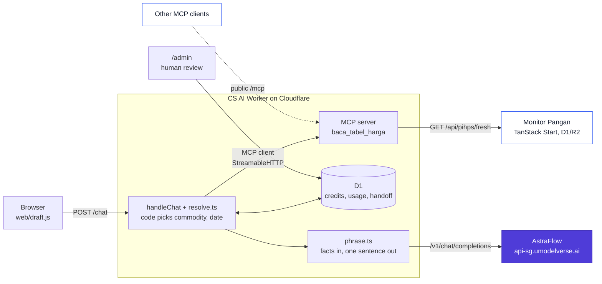

<Eyebrow>Online workshop · 120 minutes · hands-on</Eyebrow>

# How to Start Building an AI SaaS for Enterprise with AstraFlow

<p class="lede" style="max-width:31rem;margin-top:1.1rem">One real support app. A few bugs on purpose.<br/>We fix them together, line by line.</p>

<div class="flex items-center gap-4 mt-10">
  
  <span class="muted" style="font-size:1.1rem">x</span>
  
</div>

<div class="mt-4" style="font-family:'JetBrains Mono',monospace;font-size:0.8rem;letter-spacing:0.08em;text-transform:uppercase;color:var(--af-ink)">
Aldi x UCLOUD Global
</div>

<!--
Open with the title on screen. Wait for people to join.

"Today we build, not just talk.
One real support app, a few bugs I planted on purpose, and we fix them together."

Keep this short. Move to the intro.
-->

---
transition: fade-out
---

<div class="h-full flex flex-col">
<Eyebrow>Who I am</Eyebrow>

<div class="flex items-end justify-between">
  <div>
    <div style="font-size:5.6rem;font-weight:800;letter-spacing:-0.045em;line-height:0.95">I'm Aldi.</div>
    <div class="lede mt-3" style="font-size:1.45rem">Naufaldi Rafif Satriya</div>
    <div class="mt-2" style="font-family:'JetBrains Mono',monospace;font-size:0.85rem;color:var(--af-muted)">Find me <span style="color:var(--af-primary);font-weight:600">@F2aldi</span></div>
  </div>
  <IdCard v-motion :initial="{ y: 16, opacity: 0 }" :enter="{ y: 0, opacity: 1, transition: { delay: 150 } }" />
</div>

<div class="facts">
  <div class="fact" v-click>
    <div class="fact-k">Role</div>
    <div class="fact-v">Senior Software Engineer</div>
    <div class="fact-s">PT Sukanda Djaya (Diamond Cold Storage)</div>
  </div>
  <div class="fact" v-click>
    <div class="fact-k">Builds</div>
    <div class="fact-v">Monitor Pangan<br/>and the CS AI helper</div>
    <div class="fact-s">naufaldi.com · github.com/naufaldi</div>
  </div>
  <div class="fact" v-click>
    <div class="fact-k">Based in</div>
    <div class="fact-v">Bekasi / Jakarta</div>
  </div>
</div>
</div>

<style>
.facts { display: flex; gap: 2.2rem; margin-top: auto; margin-bottom: 1.2rem; }
.fact { flex: 1; border-top: 3px solid var(--af-ink); padding-top: 0.8rem; }
.fact-k { font-family: 'JetBrains Mono', monospace; font-size: 0.68rem; letter-spacing: 0.12em; text-transform: uppercase; color: var(--af-muted); }
.fact-v { margin-top: 0.5rem; font-weight: 700; font-size: 1.65rem; letter-spacing: -0.03em; line-height: 1.08; }
.fact-s { margin-top: 0.35rem; font-size: 0.9rem; color: var(--af-ink-2); }
</style>

<!--
Keep this under a minute.

"I'm Aldi. Senior Software Engineer at Sukanda Djaya, Diamond Cold Storage. Bekasi and Jakarta."

"I built Monitor Pangan and the CS AI helper. Today I'm here as an engineer, showing how I built it."

No CV dump. The app is the star today.
-->

---

<Eyebrow>Today</Eyebrow>

# 120 minutes. Five parts.

<div class="grid grid-cols-[1.15fr_1fr] gap-8 mt-2">
<div>

<table class="agenda">
<tbody>
<tr v-click><td class="t">10 min</td><td><b>Opening</b><br/><span class="muted small">why build this, what you leave with</span></td></tr>
<tr v-click><td class="t">20 min</td><td><b>The product</b><br/><span class="muted small">the case, the flow, MCP, AstraFlow</span></td></tr>
<tr v-click><td class="t">10 min</td><td><b>Setup</b><br/><span class="muted small">clone, <code>.dev.vars</code>, D1, <code>wrangler dev</code></span></td></tr>
<tr v-click><td class="t">55 min</td><td><b>Fix it together</b><br/><span class="muted small">solid, priceable, trustworthy</span></td></tr>
<tr v-click><td class="t">25 min</td><td><b>Wrap</b><br/><span class="muted small">is your idea worth building? Q&amp;A</span></td></tr>
</tbody>
</table>

</div>
<div v-click class="card tint">

### How the lab works

- you get the source code with bugs inside
- you try first, then I show the fix
- tests start red, that's normal
- AstraFlow key and free credits come today
- sample data only, no real customer data

</div>
</div>

<style>
.agenda { width: 100%; border-collapse: collapse; }
.agenda td { padding: 0.42rem 0.4rem; border-bottom: 1px solid var(--af-line); vertical-align: top; font-size: 0.98rem; }
.agenda td.t { font-family: 'JetBrains Mono', monospace; font-size: 0.8rem; color: var(--af-primary); width: 5rem; padding-top: 0.55rem; }
</style>

<!--
Walk the five rows with the arrow key.

The big block is "Fix it together". 55 minutes. That's the point of today.

Say clearly: you try first, I show the fix after.
Red tests at the start are on purpose. Don't panic.
Please don't paste real customer data anywhere.
-->

---

<Eyebrow>Why we're here</Eyebrow>

# Every company wants AI features.<br/>Few demos become a product they pay for.

<div class="grid grid-cols-2 gap-6 mt-6">
<div class="card surface" v-click>
<h3>A demo</h3>

- answers one question, on stage
- uses whatever model was handy
- never says what one answer costs
- nobody asks where the data goes

</div>
<div class="card tint" v-click>
<h3>A product a company pays for</h3>

- answers the 1,000th question the same way
- has a cost per request you can explain
- keeps customer data where it should be
- has a person to call when it's wrong

</div>
</div>

<p class="lede mt-5" v-click>So what's the gap? Mostly not the model.<br/>It's everything around it.</p>

<!--
Start with the why. Not the code.

These are observations, not stats. Ask the room: who has built an AI demo? Who got a company to pay for it?

The gap between the two columns is what we build today.
-->

---

<Eyebrow>Why we're here</Eyebrow>

# What a company asks before it pays

<div class="grid grid-cols-2 gap-4 mt-5">
<div class="card q" v-click><div class="qn">1</div><div><b>Is it correct?</b><div class="small muted">Where does the answer come from?</div></div></div>
<div class="card q" v-click><div class="qn">2</div><div><b>What does one request cost?</b><div class="small muted">And what will it cost at 100x the volume?</div></div></div>
<div class="card q" v-click><div class="qn">3</div><div><b>Where does our data go?</b><div class="small muted">Keys, customer messages, logs.</div></div></div>
<div class="card q" v-click><div class="qn">4</div><div><b>Who's accountable when it's wrong?</b><div class="small muted">Is there a human in the loop?</div></div></div>
</div>

<p class="lede mt-6" v-click>Today's app answers all four. In code you can read.<br/>We come back to these at the end.</p>

<style>
.q { display: flex; gap: 0.9rem; align-items: flex-start; }
.qn { flex: 0 0 2rem; height: 2rem; border-radius: 10px; display: grid; place-items: center; background: var(--af-primary); color: #fff; font-weight: 800; font-family: 'JetBrains Mono', monospace; }
.q b { font-size: 1.1rem; }
</style>

<!--
These four questions are the real buying criteria.

Correct. Cost. Data. Accountability.

If you can't answer them, the deal stops, no matter how good the demo looks.
-->

---

<Eyebrow>Why we're here</Eyebrow>

# Why SaaS for companies? And why you?

<div class="grid grid-cols-[1.1fr_1fr] gap-8 mt-4 items-start">
<div>
<p class="lede" v-click>Companies have problems that repeat every day.<br/>With real data behind them.</p>
<p class="lede mt-4" v-click>They pay to have one solved, every month.<br/>Not for a chat toy.</p>
<p class="lede mt-4" v-click>That's the chance for individual builders.</p>
</div>
<div class="card tint" v-click>
<h3>You don't need a big team</h3>

You need

- one narrow problem
- data you can trust
- a cost you can explain
- an answer to the four questions

</div>
</div>

<!--
Why SaaS? Because a recurring problem means recurring revenue.

Why you? Because one narrow feature doesn't need a big team. You don't need to work at a big company to build this.

That's who this workshop is for. Developers, founders, product builders.
-->

---

<Eyebrow>Why a gateway</Eyebrow>

# Why build on a gateway like AstraFlow?

<div class="grid grid-cols-2 gap-4 mt-5">
<div class="card" v-click><h3>One OpenAI-compatible API</h3><div class="small">Same request format many tools and SDKs already use.</div></div>
<div class="card" v-click><h3>Model choice</h3><div class="small">Many models behind one endpoint. Change one string to switch.</div></div>
<div class="card" v-click><h3>One key, on your server</h3><div class="small">The key lives in the Worker. The browser never sees it.</div></div>
<div class="card tint" v-click><h3>Usage you can measure</h3><div class="small">Every response returns <code>usage</code>. That's what you price on.</div></div>
</div>

<p class="small muted mt-5" v-click>That covers questions 2 and 3 at the API level. Questions 1 and 4 are on us, in our code.</p>

<!--
Keep this factual. OpenAI-compatible, many models, usage in every response. That's from the AstraFlow docs.

The key on the server is our design choice, and the gateway makes it easy.

Correctness and accountability are not something a gateway gives you. That's our job today.
-->

---

<Eyebrow>What you'll leave with</Eyebrow>

# By the end of today, you'll have

<div class="grid grid-cols-[1.25fr_1fr] gap-8 mt-3">
<div>
<Step n="1" v-click>A first AstraFlow request, and you know its token usage.</Step>
<Step n="2" v-click>A simple map of your SaaS feature. Where customer data and human review fit.</Step>
<Step n="3" v-click>A rough cost and pricing estimate.</Step>
<Step n="4" v-click tone="ok">One next step to test your idea.</Step>
</div>
<div class="card tint" v-click>
<h3>Provided today</h3>

- AstraFlow account access and an API key
- free workshop credits for the lab
- the AstraFlow team, for setup and your use case

<p class="small muted mt-2">Sample data only. Please don't bring real customer data.</p>
</div>
</div>

<!--
This is the promise from the Luma page. Say it plainly.

Credits and the key are for the lab. The AstraFlow team is in the room for questions.
-->

---

<Eyebrow>The product</Eyebrow>

# Two apps. Both live. Scan and try.

<div class="grid grid-cols-2 gap-6 mt-4">
<div class="card flex gap-5 items-center" v-click>
  <!-- TODO: swap in the real starter repo URL and regenerate this QR (public/qr/*.png) -->
  <Qr src="/qr/monitor-pangan.png" label="Monitor Pangan" url="monitor.naufaldi.com" :size="168" />
  <div>
    <h3>The data source</h3>
    <div class="small">Food prices per province, per trading date.</div>
    <div class="small mt-2 muted">TanStack Start, React 19, a Worker with D1 and R2.</div>
    <div class="mt-2"><code>/api/pihps/fresh</code></div>
  </div>
</div>
<div class="card flex gap-5 items-center" v-click>
  <!-- TODO: swap in the real starter repo URL and regenerate this QR (public/qr/*.png) -->
  <Qr src="/qr/cs-ai.png" label="CS AI helper" url="monitor-pangan-support…workers.dev" :size="168" />
  <div>
    <h3>The support chat</h3>
    <div class="small">Answers price questions from Monitor Pangan's table.</div>
    <div class="small mt-2 muted">Cloudflare Workers, D1, MCP, AstraFlow.</div>
    <div class="mt-2"><code>POST /chat</code></div>
  </div>
</div>
</div>

<div class="ph-note">QR / link placeholder, real repo link coming</div>

<p class="mt-4 lede" v-click>Today we take the second one apart.<br/>Then we put it back together, working.</p>

<!--
Ask people to scan both QR codes now.

Monitor Pangan is the data. The CS AI helper is the product we work on today.

Try asking the helper "harga cabai rawit di Jawa Barat?" and watch it answer with a trading date.

TODO before the event: swap in the real starter repo URL and regenerate the QR codes.
-->

---

<Eyebrow>The case</Eyebrow>

# Why this case?

<div class="grid grid-cols-[1.1fr_1fr] gap-8 mt-3 items-start">
<div>
  <div class="quote">"Berapa harga cabai di provinsi saya?"</div>
  <div class="muted mt-1">What's the price of chili in my province?</div>
  <p class="lede mt-5" v-click>Support gets it every day.<br/>Support gets overwhelmed.</p>
</div>
<div>
<Step n="1" v-click>The question repeats. Different province, same question.</Step>
<Step n="2" v-click tone="blue">The answer must come from real data. One price table, by trading date.</Step>
<Step n="3" v-click tone="warn">A wrong price is real damage. Someone buys or sells on it.</Step>
<p class="brand mt-4" style="font-weight:600" v-click>So the price comes from the table.<br/>The model only words it.</p>
</div>
</div>

<style>
.quote { font-size: 2rem; font-weight: 750; letter-spacing: -0.02em; line-height: 1.15; color: var(--af-primary-dark); border-left: 5px solid var(--af-primary); padding-left: 1rem; }
</style>

<!--
Small, boring, repetitive. That's what makes it a good first SaaS feature.

"Why not a plain chatbot? Because the model doesn't know today's price, but it will still answer with a number."

That one sentence decides the whole architecture we'll see next.
-->

---

<Eyebrow>Map it first</Eyebrow>

# Before coding, map the flow.

<div class="flow mt-6">
  <div class="node" v-click="1"><div class="t">Customer input</div><div class="d">A price question, in Indonesian or English</div></div>
  <div class="arrow" v-click="2">→</div>
  <div class="node" v-click="2"><div class="t">Your backend</div><div class="d">Checks credits. Finds commodity, province, date. Reads the price.</div></div>
  <div class="arrow" v-click="3">→</div>
  <div class="node hl" v-click="3"><div class="t">AstraFlow</div><div class="d">Turns the facts into one sentence</div></div>
  <div class="arrow" v-click="4">→</div>
  <div class="node" v-click="4"><div class="t">Response</div><div class="d">Reply, trading date, source line</div></div>
  <div class="arrow" v-click="5">→</div>
  <div class="node" v-click="5"><div class="t">Human review</div><div class="d">Price complaints land in <code>/admin</code></div></div>
</div>

<div class="grid grid-cols-2 gap-6 mt-8" v-click="6">
  <div class="card tint"><h3>Decide in code</h3><div class="small">What's asked, which row, can this tenant pay. All plain code you can test.</div></div>
  <div class="card"><h3>Word with the model</h3><div class="small">The model only writes the sentence. Small job, small prompt, cheap call.</div></div>
</div>

<!--
Do this before any code. Five boxes.

Most of the work is in box two, the backend. AstraFlow is one small box.

Human review is not optional for enterprise. If a customer says the price is wrong, a person looks at it.
-->

---

<Eyebrow>Architecture</Eyebrow>

# How it all talks to each other



<!--
Left to right.

Browser only talks to our Worker. Never to AstraFlow directly.

Inside the Worker, MCP is called by our own code. The same MCP server is also public at /mcp, so other agents can read the same table.

AstraFlow is the purple box. One call, at the end.

D1 holds three things: credits, usage, and handoffs.
-->

---

<Eyebrow>One question, end to end</Eyebrow>

# Follow one question, hop by hop

<div class="grid grid-cols-[1.35fr_1fr] gap-7">
<div>
<Step n="1" v-click>Browser sends <code>POST /chat</code> with <code>{ text, draft }</code> and <code>x-tenant-id</code>.</Step>
<Step n="2" v-click>Worker checks the balance in D1. Then <b>code</b>, not the model, picks commodity and date.</Step>
<Step n="3" v-click tone="blue">Worker calls the MCP tool <code>baca_tabel_harga</code>.</Step>
<Step n="4" v-click tone="blue">The tool fetches <code>/api/pihps/fresh</code> from Monitor Pangan. Falls back to cache.</Step>
<Step n="5" v-click tone="warn">Credit check. Not enough? HTTP <code>402</code>, no model call.</Step>
<Step n="6" v-click>AstraFlow phrases the facts into <b>one sentence</b> and returns <code>usage</code>.</Step>
<Step n="7" v-click tone="ok">Worker adds the source line, charges credits, logs usage.</Step>
</div>
<div v-click>
<div class="code-tag neutral">what the browser gets back</div>

```jsonc
{
  "reply": "On trading date 2026-10-07, ... per kg. Source: ...",
  "draft": { "commodity": "...", "tradingDate": "2026-10-07" },
  "outcome": "answered" // or "handoff", "refusal", "402"
}
```

<p class="small muted mt-2">Price complaints skip the model completely. Code writes a handoff row and replies.</p>
</div>
</div>

<!--
Click through slowly. Each click is one hop.

Point at hop 2. Code decides. The model has not been called yet.

Hop 5 is money. No credits, no model call, HTTP 402.

Hop 6 is the only place AstraFlow appears. One sentence.

The reply shape on the right is what web/draft.js reads.
-->

---

<Eyebrow>Design choice</Eyebrow>

# Why MCP here?

<p class="lede">Because I don't want the model to guess prices.</p>

<div class="grid grid-cols-2 gap-6 mt-4">
<div class="card" v-click>
<span class="pill bad">not what we do</span>

### Model decides when to call the tool

- the model picks the tool and the arguments
- it can skip the tool and still answer
- a made-up price looks exactly like a real one

</div>
<div class="card tint" v-click>
<span class="pill ok">what we do</span>

### Code fetches first, model only words it

- code calls `baca_tabel_harga` every time
- the model gets the facts JSON, nothing else
- failed read? no model call, no price

</div>
</div>

<div v-click>

```ts
// src/mcp/client.ts
const result = await client.callTool({
  name: "baca_tabel_harga",
  arguments: { komoditas: commodityId, tanggal_perdagangan: dateToken },
});
```

</div>

<!--
Fair question: why not let the model call tools?

Because then the model decides. It can skip the tool and answer anyway. A made-up price looks the same as a real one.

Here, MCP is a deterministic fetch. Our code calls it. The raw message is not even an argument.

Why MCP and not a normal function then? The same tool is public at /mcp, so other agents can reuse it.
-->

---

<Eyebrow>AstraFlow</Eyebrow>

# What a real AstraFlow request looks like

<div class="grid grid-cols-[0.62fr_1.38fr] gap-6 mt-2">
<div>

<p class="lede">An OpenAI-compatible API in front of many models.</p>

- one endpoint, one key
- the key stays on the server
- pick a model with one string
- Singapore endpoint, close to us

<p class="small muted mt-4">Already use the OpenAI format? You change the base URL and the key. That's it.</p>

</div>
<div>
<div class="code-tag neutral">a real request</div>

```bash {1|2|4|5-8|all}
curl https://api-sg.umodelverse.ai/v1/chat/completions \
  -H "Authorization: Bearer $ASTRAFLOW_API_KEY" \
  -H "Content-Type: application/json" \
  -d '{
    "model": "deepseek-v4.1-flash",
    "messages": [
      { "role": "system", "content": "Write one English sentence ..." },
      { "role": "user", "content": "{\"komoditas\":\"Cabai Rawit\", ...}" }
    ],
    "stream": false
  }'
```

<div class="code-tag neutral">the part we care about in the response</div>

```jsonc
"choices": [{ "message": { "content": "On trading date 2026-10-07, ..." } }],
"usage": {
  "prompt_tokens": 180, "completion_tokens": 60, "total_tokens": 240
} // example numbers
```

</div>
</div>

<!--
AstraFlow is UCLOUD's model gateway. OpenAI-compatible.

Click through the highlights: endpoint, key header, model, messages.

The usage block at the bottom matters a lot later. That's how we count tokens and charge credits. The numbers here are example numbers.
-->

---

<Eyebrow>Setup · 10 min</Eyebrow>

# Get it running locally

<div class="grid grid-cols-[1.25fr_1fr] gap-6 mt-2">
<div>

```bash
# 1. get the starter (link is in the chat)
git clone <starter-repo-url> astra-cs && cd astra-cs
npm install

# 2. local secrets
cp .dev.vars.example .dev.vars

# 3. local D1 database
npx wrangler d1 migrations apply monitor-pangan-handoff --local

# 4. run it
npx wrangler dev        # http://localhost:8787
```

<!-- TODO: replace <starter-repo-url> with the real starter repo URL -->
<div class="ph-note">QR / link placeholder, real repo link coming</div>

</div>
<div>
<div class="code-tag neutral">.dev.vars</div>

```ini
ASTRAFLOW_API_KEY=   # workshop key, from today
# Optional. Blank means deepseek-v4.1-flash.
ASTRAFLOW_MODEL=
WORKSHOP_KEY=
```

<div class="card surface mt-3 small" v-click>

The migration seeds a `demo` tenant with **50 credits**.

`.dev.vars` is already in `.gitignore`. Keep it that way.

</div>
</div>
</div>

<!--
Give people time here. Watch the chat.

Common problems: old Node version, wrangler login prompt. Local dev doesn't need a Cloudflare login for D1 --local.

Once wrangler dev is up, open localhost:8787 and send one question.

TODO before the event: swap in the real starter repo URL in the clone command (and the QR codes).
-->

---

<Eyebrow>Setup</Eyebrow>

# Some parts are broken on purpose.

<div class="grid grid-cols-[1fr_1fr] gap-7 mt-2">
<div>

```bash
npm test                # the app's own tests
npm run test:exercise   # starts red. That's fine.
```

<p class="lede mt-6">Red means there's work to do.<br/>Green means you fixed it.</p>

<p class="small muted mt-3">Stuck on one bug? Skip it, we fix it together on screen.</p>

</div>
<div v-click>

| # | What's broken | Where to look |
|---|---|---|
| 1 | first AstraFlow call | `src/agent/phrase.ts` |
| 2 | key in the browser | `web/draft.js` |
| 3 | model id | `phrase.ts`, `.dev.vars` |
| 4 | token usage | `src/workshop/token-usage.ts` |
| 5 | cost math | `token-usage.ts` |
| 6 | credit gate | `src/workshop/charge-credits.ts` |
| 7 | upstream errors | `phrase.ts`, `handle-request.ts` |
| 8 | grounding, handoff | `phrase.ts`, `handle-request.ts` |

</div>
</div>

<!--
Run both commands now.

npm run test:exercise is supposed to fail at the start. Say it twice.

This table is the map for the next 55 minutes.
-->

---
class: section-slide
---

<Eyebrow>Fix it together · Part 1</Eyebrow>

# Make the first request solid.

<p class="lede mt-2">If the first request isn't solid, nothing else matters.</p>

<div class="mt-6" style="max-width:36rem">
<Step n="1" v-click>the endpoint</Step>
<Step n="2" v-click>the key</Step>
<Step n="3" v-click>the model id</Step>
</div>

<!--
Three bugs, all about the first call. Wrong URL, leaked key, wrong model.

About 15 minutes for this part.
-->

---

<Eyebrow>Fix it together · <span class="bug-num">Bug 1</span></Eyebrow>

# The first request to AstraFlow fails

<div class="bug-grid">
<div class="bug-side">
  <div class="row"><span class="k sym">Symptom</span><span class="v">Every customer gets "The price answer could not be written." Support is still overwhelmed.</span></div>
  <div class="row" v-click><span class="k hint">Hint</span><span class="v">Look at the URL. Chat model, or the old text completion API?</span></div>
  <div class="row" v-click><span class="k fix">Fix</span><span class="v">Chat models live at <code>/v1/chat/completions</code>.</span></div>
  <p class="small muted mt-4" v-after>Check the Worker log. The upstream error class is kept, the key is redacted.</p>
</div>
<div>
<div class="code-tag bug">buggy · src/agent/phrase.ts</div>
<div class="code-bug">

```ts {2}
response = await fetchImpl(
  "https://api-sg.umodelverse.ai/v1/completions",
  { method: "POST", headers, body },
);
```

</div>
<div v-click="2">
<div class="code-tag fix">fixed</div>
<div class="code-fix">

```ts {2}
response = await fetchImpl(
  "https://api-sg.umodelverse.ai/v1/chat/completions",
  {
    method: "POST",
    headers: {
      authorization: `Bearer ${options.apiKey}`,
      "content-type": "application/json",
    },
    body: JSON.stringify({ model, messages, stream: false }),
  },
);
```

</div>
</div>
</div>
</div>

<!--
Give people 5 minutes before you click.

"Why does it fail? Look at the path."

/v1/completions is the old text API. Chat models want /v1/chat/completions.

Show the Worker log after the fix. One answered line.
-->

---

<Eyebrow>Fix it together · <span class="bug-num">Bug 2</span></Eyebrow>

# The API key leaks to the browser

<div class="bug-grid">
<div class="bug-side">
  <div class="row"><span class="k sym">Symptom</span><span class="v">Anyone who opens DevTools can copy your AstraFlow key. Your credits become their credits.</span></div>
  <div class="row" v-click><span class="k hint">Hint</span><span class="v">Who should call AstraFlow? The browser or the Worker?</span></div>
  <div class="row" v-click><span class="k fix">Fix</span><span class="v">The browser only talks to <code>/chat</code>. The Worker reads the key from a secret.</span></div>
  <div class="card tint small mt-4" v-after>Try it. Network tab, look at the request headers.</div>
</div>
<div>
<div class="code-tag bug">buggy · web/draft.js (runs in the browser)</div>
<div class="code-bug">

```js {3}
const url = "https://api-sg.umodelverse.ai/v1/chat/completions";
await fetch(url, {
  headers: { authorization: "Bearer sk-workshop-..." },
  body: JSON.stringify({ model, messages }),
});
```

</div>
<div v-click="2">
<div class="code-tag fix">fixed · browser → Worker → AstraFlow</div>
<div class="code-fix">

```js
// web/draft.js: the browser only knows /chat
await fetch("/chat", {
  method: "POST",
  headers,
  body: JSON.stringify({ text, draft: readDraft() }),
});
// src/routes.ts: the Worker reads the secret
apiKey: env.ASTRAFLOW_API_KEY,
```

```bash
npx wrangler secret put ASTRAFLOW_API_KEY  # prod
# local dev reads .dev.vars, which git ignores
```

</div>
</div>
</div>
</div>

<!--
Ask someone to open DevTools and read the header out loud. That usually lands the point.

The fix is moving the call, not hiding the key better.

Browser calls /chat. Worker holds the key as a secret.
-->

---

<Eyebrow>Fix it together · <span class="bug-num">Bug 3</span></Eyebrow>

# Wrong model id, AstraFlow says 400

<div class="bug-grid">
<div class="bug-side">
  <div class="row"><span class="k sym">Symptom</span><span class="v">The feature is down for everyone. AstraFlow answers HTTP <code>400</code> with <code>param_error</code>.</span></div>
  <div class="row" v-click><span class="k hint">Hint</span><span class="v">Model ids are exact strings. Ask the API which ones exist.</span></div>
  <div class="row" v-click><span class="k fix">Fix</span><span class="v">Use <code>deepseek-v4.1-flash</code>, or set <code>ASTRAFLOW_MODEL</code> to an id from <code>/v1/models</code>.</span></div>
</div>
<div>
<div class="code-tag bug">buggy · src/agent/phrase.ts</div>
<div class="code-bug">

```ts {2}
body: JSON.stringify({
  model: "deepseek-ai/DeepSeek-V3",
  messages: payload.messages,
}),
```

</div>
<div v-click="2">
<div class="code-tag fix">fixed</div>
<div class="code-fix">

```ts
export const defaultAstraFlowModel = "deepseek-v4.1-flash";

function resolvedModel(model: string | undefined): string {
  const override = model?.trim();
  return override ? override : defaultAstraFlowModel;
}
```

</div>
<div class="code-tag neutral">check what exists</div>

```bash
curl -s https://api-sg.umodelverse.ai/v1/models \
  -H "Authorization: Bearer $ASTRAFLOW_API_KEY" | jq -r '.data[].id'
```

</div>
</div>
</div>

<!--
"deepseek-ai/DeepSeek-V3" looks right. It's not an id on this endpoint.

Run the /v1/models curl together. Read the list.

Model id is config, not a guess. Default lives in one constant.
-->

---

<Eyebrow>Switching models</Eyebrow>

# Want another model? One variable.

<div class="grid grid-cols-[0.9fr_1.1fr] gap-7 mt-1">
<div>

<Step n="1">Pick an id from <code>/v1/models</code>.</Step>
<Step n="2">Set <code>ASTRAFLOW_MODEL</code> in <code>.dev.vars</code>. In production, a Worker var or secret.</Step>
<Step n="3" tone="warn">Update the price table too.</Step>

<div class="card tint mt-4" v-click>

### Why the price table?

Because cost and credits are computed from it.

Skip it and `/admin` shows the cost of the old model.

</div>
</div>
<div>
<div class="code-tag neutral">.dev.vars</div>

```ini
ASTRAFLOW_MODEL=your-new-model-id
```

<div class="code-tag neutral">src/workshop/token-usage.ts</div>

```ts {2-8}
export const modelPrice = {
  model: "deepseek-v4.1-flash",
  peak: {
    inputPerMillionUsd: 0.286, outputPerMillionUsd: 1.144,
  },
  offPeak: {
    inputPerMillionUsd: 0.143, outputPerMillionUsd: 0.572,
  },
  idrPerUsd: 16_500, // workshop rate, not a live FX quote
} as const;
```

<p class="small muted">Prices are USD per 1M tokens, from <code>pricing.windows</code> in <code>/v1/models</code>.<br/>Peak is 08 to 11 and 13 to 17 WIB, exactly double off-peak.</p>
</div>
</div>

<!--
Switching is easy. That's the trap.

The model string changes in one place. The money math lives somewhere else.

Peak windows are in UTC in the code. In WIB that's 08 to 11 and 13 to 17.
-->

---
class: section-slide
---

<Eyebrow>Fix it together · Part 2</Eyebrow>

# Make it priceable.

<p class="lede mt-2">A company won't buy what you can't price.</p>

<div class="mt-6" style="max-width:36rem">
<Step n="4" v-click>token usage</Step>
<Step n="5" v-click>cost math</Step>
<Step n="6" v-click>the credit gate</Step>
</div>

<!--
This is the business part. Count tokens, turn them into cost, then into a price.

About 20 minutes, including the margin talk.
-->

---

<Eyebrow>Fix it together · <span class="bug-num">Bug 4</span></Eyebrow>

# Token usage is never read

<div class="bug-grid">
<div class="bug-side">
  <div class="row"><span class="k sym">Symptom</span><span class="v">You can't tell a customer what they used. <code>/admin</code> shows 0 tokens, even after 20 chats.</span></div>
  <div class="row" v-click><span class="k hint">Hint</span><span class="v">AstraFlow returns <code>usage</code> in snake_case, same as OpenAI.</span></div>
  <div class="row" v-click><span class="k fix">Fix</span><span class="v">Read <code>prompt_tokens</code>, <code>completion_tokens</code>, <code>total_tokens</code>.</span></div>
  <div class="mt-4" v-after>
  <div class="code-tag neutral">the response field, example numbers</div>

```jsonc
"usage": {
  "prompt_tokens": 180,
  "completion_tokens": 60,
  "total_tokens": 240
}
```

  </div>
</div>
<div>
<div class="code-tag bug">buggy · src/workshop/token-usage.ts</div>
<div class="code-bug">

```ts {3-5}
const record = usage as Record<string, unknown>;
return {
  promptTokens: numberField(record, "promptTokens"),
  completionTokens: numberField(record, "completionTokens"),
  totalTokens: numberField(record, "totalTokens"),
};
```

</div>
<div v-click="2">
<div class="code-tag fix">fixed</div>
<div class="code-fix">

```ts {3-5}
const record = usage as Record<string, unknown>;
return {
  promptTokens: numberField(record, "prompt_tokens"),
  completionTokens: numberField(record, "completion_tokens"),
  totalTokens: numberField(record, "total_tokens"),
};
```

</div>
</div>
</div>
</div>

<!--
No error here. That's what makes it nasty. Everything looks fine, the numbers are just zero.

numberField returns 0 when the key is missing. So a wrong key name fails silently.

After the fix, send 3 questions and refresh /admin.
-->

---

<Eyebrow>Fix it together · <span class="bug-num">Bug 5</span></Eyebrow>

# The cost math is off

<div class="bug-grid">
<div class="bug-side">
  <div class="row"><span class="k sym">Symptom</span><span class="v">Your cost looks 1,000x too high, so you price yourself out. Or rates are swapped and you under-charge.</span></div>
  <div class="row" v-click><span class="k hint">Hint</span><span class="v">Prices are per <b>1M</b> tokens. Output costs 4x input.</span></div>
  <div class="row" v-click><span class="k fix">Fix</span><span class="v">Divide by <code>1_000_000</code> and use the right rate for each side.</span></div>
  <div class="mt-3" v-click>

```bash
npm run cost:estimate
```

  <table class="proj">
  <thead><tr><th>chats / month</th><th>USD</th><th>IDR</th></tr></thead>
  <tbody>
  <tr><td>1,000</td><td>$0.024</td><td>Rp396</td></tr>
  <tr><td>10,000</td><td>$0.24</td><td>Rp3,964</td></tr>
  <tr><td>100,000</td><td>$2.40</td><td>Rp39,640</td></tr>
  </tbody>
  </table>
  <p class="tiny muted">Labelled example from the script: 180 + 60 tokens, 40% of chats hit the model, off-peak. Your numbers come from your local D1.</p>
  </div>
</div>
<div>
<div class="code-tag bug">buggy · src/workshop/token-usage.ts</div>
<div class="code-bug">

```ts {2-3}
const usd =
  (promptTokens / 1_000) * rate.outputPerMillionUsd +
  (completionTokens / 1_000) * rate.inputPerMillionUsd;
```

</div>
<div v-click="2">
<div class="code-tag fix">fixed</div>
<div class="code-fix">

```ts {3-4}
const rate = isPeakUtc(now) ? modelPrice.peak : modelPrice.offPeak;
const usd =
  (promptTokens / 1_000_000) * rate.inputPerMillionUsd +
  (completionTokens / 1_000_000) * rate.outputPerMillionUsd;
const estCostUsd = Math.round(usd * 1e8) / 1e8;
const estCostIdr = Math.round(estCostUsd * modelPrice.idrPerUsd);
```

</div>
</div>
</div>
</div>

<style>
.proj { width: 100%; margin-top: 0.3rem; }
.proj td, .proj th { padding: 0.2rem 0.45rem !important; font-size: 0.78rem; }
.proj td:nth-child(n+2) { font-family: 'JetBrains Mono', monospace; }
</style>

<!--
Two mistakes in three lines. Wrong divisor, swapped rates.

Then run npm run cost:estimate. If your D1 has answered chats, it uses your real average. If not, it prints the labelled example.

Point out: refusals and handoffs don't call the model, so they're free. That's why only 40% count in the example.
-->

---
zoom: 0.94
---

<Eyebrow>Fix it together · <span class="bug-num">Bug 6</span></Eyebrow>

# The credit limit can be bypassed

<div class="bug-grid">
<div class="bug-side">
  <div class="row"><span class="k sym">Symptom</span><span class="v">Credits run out, model calls keep going. You pay for usage nobody pays you for.</span></div>
  <div class="row" v-click><span class="k hint">Hint</span><span class="v">One call can cost more than what's left. So the gate is 2 credits.</span></div>
  <div class="row" v-click><span class="k fix">Fix</span><span class="v">Check <code>&gt;= GATE_TOKENS</code>. Short? HTTP <code>402</code>, no model call.</span></div>
  <div class="card tint mt-3" v-click>
  <h3>Now, pricing</h3>

```txt
CREDIT_PRICE_IDR  = 100   // Rp100
TOKENS_PER_CREDIT = 1000
GATE_TOKENS       = 2000  // 2 credits

price = total_tokens / 1000 × Rp100
cost  = from Bug 5, in IDR
margin = ?  we work it out live
```

  </div>
</div>
<div>
<div class="code-tag bug">buggy · src/workshop/charge-credits.ts</div>
<div class="code-bug">

```ts {4}
export function passesCreditGate(
  balanceTokens: number,
): boolean {
  return balanceTokens > 0;
}
```

</div>
<div v-click="2">
<div class="code-tag fix">fixed</div>
<div class="code-fix">

```ts {4}
export function passesCreditGate(
  balanceTokens: number,
): boolean {
  return balanceTokens >= GATE_TOKENS;
}
```

```ts
// src/routes.ts
const status = result.outcome === "402" ? 402 : 200;
```

</div>
</div>
</div>
</div>

<!--
"> 0" sounds fine. But a call with 1 token of balance still runs, and the tenant goes into overdraft.

The gate is 2 credits, 2,000 tokens, because one reply can be bigger than what's left.

Pricing: don't give the answer. Ask the room. Take the tokens per chat from /admin, price it at Rp100 per 1,000 tokens, compare with the cost from Bug 5. Write the numbers live.
-->

---
class: section-slide
---

<Eyebrow>Fix it together · Part 3</Eyebrow>

# Make it trustworthy.

<p class="lede mt-2">Enterprise trust is errors, grounding, and humans in control.</p>

<div class="mt-6" style="max-width:36rem">
<Step n="7" v-click>when AstraFlow fails</Step>
<Step n="8" v-click>made-up prices and lost complaints</Step>
</div>

<!--
Last part. What happens when things go wrong, and who decides.

About 15 minutes. Early finishers move to the bonus.
-->

---

<Eyebrow>Fix it together · <span class="bug-num">Bug 7</span></Eyebrow>

# AstraFlow has a bad minute, so do we

<div class="bug-grid">
<div class="bug-side">
  <div class="row"><span class="k sym">Symptom</span><span class="v">AstraFlow has a <code>429</code> or <code>5xx</code>, and your customer sees a crash, not an answer.</span></div>
  <div class="row" v-click><span class="k hint">Hint</span><span class="v"><code>fetch</code> doesn't throw on 4xx or 5xx. You have to check.</span></div>
  <div class="row" v-click><span class="k fix">Fix</span><span class="v">Check <code>response.ok</code>. Add a timeout. Reply with something friendly.</span></div>
  <div class="card surface small mt-3" v-after>
  Want an answer anyway?<br/><code>phraseFromFacts(facts, language)</code> writes the same sentence from a template. No model, no cost.
  </div>
</div>
<div>
<div class="code-tag bug">buggy · src/agent/phrase.ts</div>
<div class="code-bug">

```ts
const response = await fetchImpl(url, init);
const body = await response.json();
const reply = completionText(body)!;
```

</div>
<div v-click="2">
<div class="code-tag fix">fixed</div>
<div class="code-fix">

```ts {3,5-7}
const response = await fetchImpl(url, {
  ...init,
  signal: AbortSignal.timeout(8_000),
});
if (!response.ok) {
  throw await wordingFailure(response); // keeps http_429
}
```

```ts
// src/agent/handle-request.ts: friendly reply, no crash
} catch (error) {
  return finish({ reply: replies[language].wording, /* ... */ });
}
```

</div>
</div>
</div>
</div>

<!--
Every upstream fails sometimes. Rate limit, a bad deploy, a slow minute.

fetch only throws on network errors. A 429 is a normal response.

The timeout line is something we add today. Pick a number that fits your UX.

Fallback idea: the template phraser already exists. Same facts, no model.
-->

---
zoom: 0.9
---

<Eyebrow>Fix it together · <span class="bug-num">Bug 8</span></Eyebrow>

# Made-up prices, and complaints that go nowhere

<div class="grid grid-cols-2 gap-5">
<div class="bug-side">
  <div class="row"><span class="k sym">Symptom</span><span class="v">A customer acts on a price that was never published. The model said "today's price is..." with a number not in the table.</span></div>
  <div class="row" v-click="1"><span class="k fix">Fix</span><span class="v">Send only the facts JSON. Strict prompt. No raw message.</span></div>
</div>
<div class="bug-side">
  <div class="row"><span class="k sym">Symptom</span><span class="v">A customer reports a wrong price and nobody hears about it. "Di pasar Rp80.000, kok beda?" never reaches <code>/admin</code>.</span></div>
  <div class="row" v-click="2"><span class="k fix">Fix</span><span class="v">Code writes the handoff row. No model call on this path.</span></div>
</div>
</div>

<div class="grid grid-cols-2 gap-5 mt-1">
<div>
<div class="code-tag bug">buggy · grounding</div>
<div class="code-bug">

```ts
messages: [
  { role: "system", content: "You are a helpful assistant." },
  { role: "user", content: rawText },
],
```

</div>
<div v-click="1">
<div class="code-tag fix">fixed · src/agent/phrase.ts</div>
<div class="code-fix">

```ts
const englishPrompt =
  "Write one English sentence using only the " +
  "price facts given. Name the trading date. " +
  "Do not call it today's price. Do not add " +
  "numbers. Do not add a source line.";
// user message: the facts JSON, nothing else
const user = JSON.stringify(wordingFacts(facts));
```

</div>
</div>
</div>
<div>
<div class="code-tag bug">buggy · handoff</div>
<div class="code-bug">

```ts
if (resolved.type === "claim") {
  // tells the customer "we'll review it"...
  return finish({ reply, outcome: "handoff" });
}  // ...but no row is ever written
```

</div>
<div v-click="2">
<div class="code-tag fix">fixed · src/agent/handle-request.ts</div>
<div class="code-fix">

```ts {5-10}
if (resolved.type === "claim") {
  const filled = await fillClaim(
    resolved, input.readTable,
  );
  await input.writeHandoff({
    commodity: filled.commodity,
    province: filled.province ?? "tidak disebut",
    displayedPrice: filled.displayedPrice ?? 0,
    claimedPrice: resolved.claimedPrice,
  });
```

</div>
</div>
</div>
</div>

<!--
Two bugs, one theme: who is in control.

Grounding: the model only sees the facts. The prompt says name the trading date, never say today's price, never add numbers.

Handoff: the buggy version says "we'll review it" but never writes the row. That's lying to the customer.

After the fix, send the complaint and open /admin. The row is there.
-->

---

<Eyebrow>Bonus · early finishers</Eyebrow>

# Done early? Two more.

<div class="grid grid-cols-2 gap-6 mt-1">
<div class="card">
<span class="pill">exercise</span>

### The identity gate

A name and a phone must stay out of the AstraFlow payload, the log, and storage.

```ts
// test/exercise/identity-gate.test.ts
const text =
  "Berapa harga beras di Aceh? " +
  "Nama saya Budi, telepon 081234567890";
// ...
expect(payload).not.toContain("Budi");
expect(payload).not.toContain("081234567890");
```

<p class="small muted" v-click>Hint: look at <code>buildWordingPayload</code>. Where does <code>rawText</code> go?</p>
</div>
<div class="card">
<span class="pill blue">your rule</span>

### One more guardrail

An empty stub. Return a refusal to stop before any price read or model call.

```ts
// src/agent/extra-guardrail.ts
export function extraGuardrail(
  _normalized: string,
  _language: ReplyLanguage,
): string | null {
  return null;
}
```

<p class="small muted" v-click>Ideas: block a topic you don't serve. Bilingual, please.</p>
</div>
</div>

<!--
For people who finish early. The rest keep fixing.

Identity gate: run npm run test:exercise. Green means done.

Extra guardrail: anything you think a real customer would abuse. Keep it bilingual, Indonesian and English.
-->

---

<Eyebrow>Wrap · back to the start</Eyebrow>

# Remember the four questions?

<table class="tie mt-2">
<thead><tr><th>The company asks</th><th>What answered it today</th></tr></thead>
<tbody>
<tr v-click><td><b>Is it correct?</b></td><td>Code fetches the price through MCP. The model only words the facts. Bug 8.</td></tr>
<tr v-click><td><b>What does one request cost?</b></td><td>Read <code>usage</code>, do the math right, gate on credits. Bugs 4 to 6.</td></tr>
<tr v-click><td><b>Where does our data go?</b></td><td>Key on the server. Facts in the payload, not names. Content-free logs. Bug 2 and the bonus.</td></tr>
<tr v-click><td><b>Who's accountable when it's wrong?</b></td><td>Complaints become a handoff in <code>/admin</code>. A person decides. Bug 8.</td></tr>
</tbody>
</table>

<p class="lede mt-5" v-click>Have these four answers before the demo.<br/>Not after the security review.</p>

<style>
.tie { width: 100%; border-collapse: collapse; }
.tie td { padding: 0.55rem 0.6rem; border-bottom: 1px solid var(--af-line); font-size: 0.95rem; vertical-align: top; }
.tie td:first-child { width: 17rem; color: var(--af-primary-dark); }
</style>

<!--
Close the loop with the opening slide.

Each question maps to bugs we just fixed. Point at them one by one.

That's the difference between a demo and something a company pays for.
-->

---

<Eyebrow>Same pattern, other problems</Eyebrow>

# It's not only about chili prices.

<div class="flex gap-2 items-center mt-1 small">
<span class="pill">input</span><span class="brand">→</span>
<span class="pill">code decides, fetches facts</span><span class="brand">→</span>
<span class="pill">AstraFlow words it</span><span class="brand">→</span>
<span class="pill ok">a human decides</span>
</div>

<div class="grid grid-cols-2 gap-6 mt-5">
<div class="card" v-click>
<h3>Compliance review</h3>

- input is a document or a clause
- code matches it to the policy checklist
- the model writes the gap in plain words
- the compliance person approves or rejects

</div>
<div class="card" v-click>
<h3>Security triage</h3>

- input is an alert
- code dedupes it and adds the owner and severity
- the model writes a short summary for on-call
- a person decides to escalate or close

</div>
</div>

<p class="muted small mt-4" v-click>Same rule as today. Decide in code, word with the model, keep a human on the final call.</p>

<!--
This is how I'd start these two, using today's pattern. Not a finished product.

The structure stays the same. Only the facts source changes.

Ask: what's a problem like this in your company?
-->

---

<Eyebrow>Your idea</Eyebrow>

# Is your idea worth building?

<div class="grid grid-cols-2 gap-4 mt-4">
<div class="card ck" v-click><span class="box"></span><div><b>Useful?</b><div class="small muted">A problem that repeats, with real data behind it.</div></div></div>
<div class="card ck" v-click><span class="box"></span><div><b>Affordable per request?</b><div class="small muted">Cost from real <code>usage</code>, and a price that covers it.</div></div></div>
<div class="card ck" v-click><span class="box"></span><div><b>Safe with customer data?</b><div class="small muted">Keys on the server, only facts to the model, no transcripts.</div></div></div>
<div class="card ck" v-click><span class="box"></span><div><b>Human in the loop?</b><div class="small muted">A person decides the cases that matter.</div></div></div>
</div>

<p class="lede mt-6" v-click>Four yes? Build the smallest version.<br/>One no? Fix that first.</p>

<style>
.ck { display: flex; gap: 0.85rem; align-items: flex-start; }
.ck .box { flex: 0 0 1.3rem; height: 1.3rem; margin-top: 0.15rem; border: 2px solid var(--af-primary); border-radius: 5px; }
.ck b { font-size: 1.1rem; }
</style>

<!--
Give people a minute to check their own idea against this.

It's the same four questions, turned into a checklist.
-->

---

<Eyebrow>Your turn</Eyebrow>

# One next step to test it

<div class="grid grid-cols-[1.2fr_1fr] gap-8 mt-2 items-center">
<div>
<Step n="1" v-click>Pick one company problem you see every week.</Step>
<Step n="2" v-click>Map it. Input, backend, AstraFlow, response, human.</Step>
<Step n="3" v-click>Make one request with sample data. Read the <code>usage</code>.</Step>
<Step n="4" v-click tone="ok">Price it, then show it to one company that has the problem.</Step>
</div>
<div class="card tint text-center" v-click>
<div style="font-size:2.6rem;font-weight:800;letter-spacing:-0.03em;color:var(--af-primary)">Q&amp;A</div>
<div class="mt-2">Ask anything.<br/>The AstraFlow team is here too.</div>
</div>
</div>

<!--
Four small steps. None of them need a big team.

Then open Q&A. Bring in the AstraFlow team for setup and pricing questions.
-->

---
layout: thanks
---

<div class="h-full flex flex-col justify-center">
<Eyebrow>Thanks everyone</Eyebrow>

<div style="font-size:3.6rem;font-weight:800;letter-spacing:-0.04em;line-height:1">Thank you.</div>

<div class="flex gap-10 mt-8">
  <!-- TODO: swap in the real starter repo URL and regenerate this QR (public/qr/*.png) -->
  <Qr src="/qr/luma.png" label="Event page" url="luma.com/c0socj8g" :size="128" />
  <Qr src="/qr/cs-ai.png" label="CS AI helper" url="monitor-pangan-support.naufaldi-rafif.workers.dev" :size="128" />
  <Qr src="/qr/monitor-pangan.png" label="Monitor Pangan" url="monitor.naufaldi.com" :size="128" />
</div>
<div class="mt-4"><div class="ph-note">QR / link placeholder, real repo link coming</div></div>

<div class="flex items-center gap-4 mt-8">
  <span style="font-family:'JetBrains Mono',monospace;font-size:0.85rem">Find me <b style="color:var(--af-primary)">@F2aldi</b></span>
  <span class="muted">·</span>
  
  <span class="muted">x</span>
  
</div>
</div>

<!--
Thank people for staying the full two hours.

Leave this slide up during the last questions so people can scan the QR codes.

TODO before the event: swap in the real starter repo URL and regenerate the QR codes.
-->
